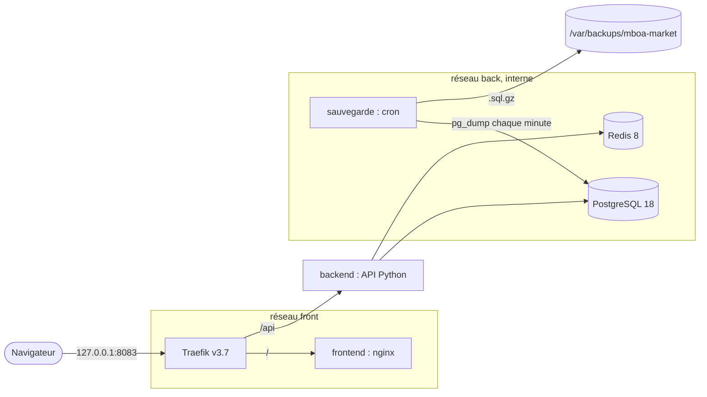

# Mboa Market

[](https://github.com/À-COMPLÉTER/mboa-market/actions/workflows/ci.yml)

La boutique en ligne d'un marché de quartier : six conteneurs, décrits dans un seul fichier,
`compose.yaml`. Projet 2 de la formation « Devenir ingénieur DevOps ».

<!-- À COMPLÉTER : remplace ce commentaire par une phrase à toi : ce que tu as construit, et pour qui. -->

## Ce qu'il y a dedans



| Service | Image | Son rôle | Réseau | Port publié |
|---|---|---|---|---|
| `traefik` | `traefik:v3.7` | la seule porte : `/` vers le site, `/api` vers l'API | front | `127.0.0.1:8083` (la boutique), `127.0.0.1:8084` (le tableau de bord) |
| `frontend` | `mboa-frontend:1.0`, construite ici | la page de la boutique (nginx) | front | aucun |
| `backend` | `mboa-api:3.0`, construite ici | l'API : les produits, le cache, le compteur de visites | front et back | aucun |
| `db` | `postgres:18-alpine` | les données, dans le volume `pgdata` | back | aucun |
| `redis` | `redis:8.10-alpine` | la liste des produits en cache (30 s), le compteur | back | aucun |
| `sauvegarde` | `mboa-sauvegarde:1.0`, construite ici | `pg_dump` chaque minute ; la dernière heure est gardée | back | aucun |

## La démarrer

Sur un serveur Linux avec Docker Engine et le plugin Compose (`docker compose version`) :

```bash
git clone https://github.com/À-COMPLÉTER/mboa-market.git
cd mboa-market
cp .env.exemple .env && chmod 600 .env
sed -i "s/^POSTGRES_PASSWORD=.*/POSTGRES_PASSWORD=$(openssl rand -hex 16)/" .env
sed -i "s/^REDIS_PASSWORD=.*/REDIS_PASSWORD=$(openssl rand -hex 16)/" .env
sudo install -d -m 700 /var/backups/mboa-market
sudo docker compose up -d --build
sudo docker compose ps                        # six services, « healthy »
curl -s http://127.0.0.1:8083/api/sante       # {"etat":"ok","base":"ok","cache":"ok"}
```

La boutique n'écoute que sur le serveur lui-même (`127.0.0.1`). Depuis ton ordinateur, ouvre un
tunnel SSH, puis http://localhost:8083 (la boutique) et http://localhost:8084/dashboard/ (Traefik) :

```bash
ssh -N -L 8083:127.0.0.1:8083 -L 8084:127.0.0.1:8084 <compte>@<serveur>
```

## Les sauvegardes

- Le service `sauvegarde` lance `pg_dump` chaque minute (`sauvegarde/crontab`). Le fichier est
  compressé, relu (`gzip -t`), et ne prend son nom en `.sql.gz` qu'une fois complet.
- Les fichiers arrivent dans `/var/backups/mboa-market` (réglable dans `.env` :
  `DOSSIER_SAUVEGARDES`), hors du dépôt : ils ne partent jamais sur GitHub. Droits 600 : root
  seul les lit.
- La dernière heure est gardée (`GARDER_MINUTES`). Le service est `healthy` tant que la dernière
  sauvegarde a moins de 2 minutes.

Restaurer :

```bash
sudo ./restaurer.sh                                                          # la liste
sudo ./restaurer.sh /var/backups/mboa-market/boutique-AAAAMMJJ-HHMM.sql.gz   # celle-ci
```

Choisis la sauvegarde d'**avant** l'incident : juste après une panne, la plus récente peut être
celle d'une base vide.

Chaque minute, c'est pour voir les fichiers arriver. En production : une sauvegarde par nuit,
gardée plusieurs semaines, et une copie hors du serveur (la règle 3-2-1).

## La sécurité

- **Une seule porte** : Traefik, sur `127.0.0.1` seulement. Ni la base, ni Redis, ni l'API ne
  publient de port, et le réseau `back` est interne (pas d'Internet).
- **Les secrets** sont dans `.env` (droits 600), jamais dans Git : `.gitignore` le refuse, et la CI
  le vérifie à chaque push.
- **L'API** tourne sous un compte sans droits (uid 10001). **Redis** demande un mot de passe.
- **Traefik lit le socket Docker**, en lecture seule (`:ro`). Attention : `:ro` empêche de
  remplacer le fichier, pas de donner des ordres à Docker. Qui contrôle Traefik contrôle le
  serveur. En production, on met devant un proxy du socket qui ne laisse passer que la lecture.
- **Le tableau de bord** de Traefik n'a pas de mot de passe (`--api.insecure`) : il reste sur
  `127.0.0.1`.

## Ce que j'ai appris

<!-- À COMPLÉTER : remplace ce commentaire par trois choses que tu as apprises, avec tes mots. -->

## Auteur

À COMPLÉTER : ton prénom, ton nom, et un lien vers ton profil (GitHub ou LinkedIn).

Licence MIT : voir `LICENSE`.
